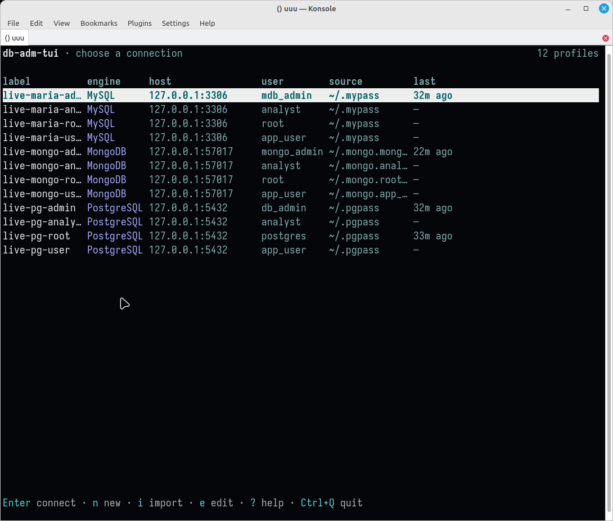
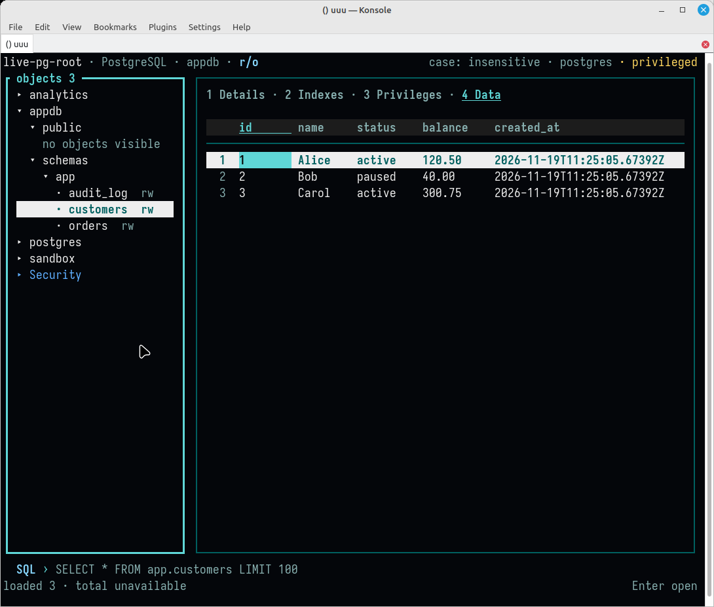
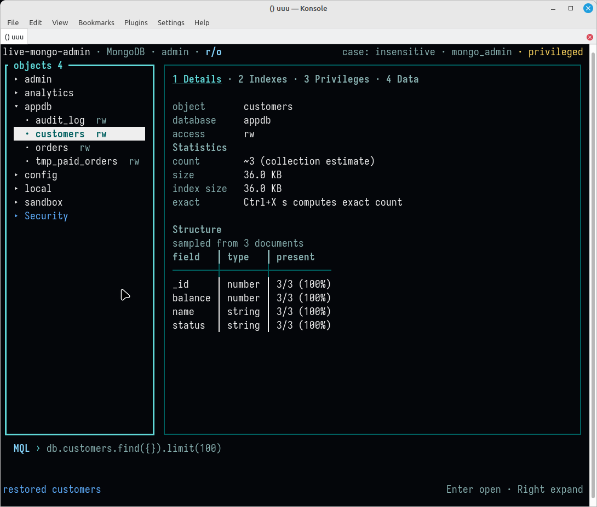

# db-adm-tui

Terminal database administration for PostgreSQL, MongoDB, and MySQL/MariaDB,
built to run on the database host inside a closed environment.

The repository now implements the connection layer, the real catalog tree, and
read-only data browsing with search: profiles and import, connect-time password
resolution, real open/ping/close, lazy database/schema/object navigation, a
Security node with users and roles, native access markers, a paged Data tab with
a bounded loaded window, an inline `/` filter with match navigation, a
server-side `Ctrl+f` regexp filter, a session-wide search case mode, object
statistics with exact count, index/structure details, native privilege
inspection, an access matrix for role membership and object privileges, a query
bar with Results, completion, context help, and history, and a read-only default
with an explicit read-write switch.

## Requirements

- Go 1.26+ (`go.mod` declares `go 1.26.0`; Bubble Tea v2 requires 1.26+).
- A UTF-8 terminal at least **80×24**. Smaller terminals show only
  `Terminal too small: need 80×24. Current WxH.`
- `cgo` is needed for `go test -race`; the shipped binary is built with
  `CGO_ENABLED=0`.

## Build and run

```sh
make build
./bin/db-adm-tui
```

### Screenshots








### Keyboard shortcuts

#### Global keys

| Key | Action |
|---|---|
| `Tab` / `Shift+Tab` | Move focus between workspace zones and fields in forms; in the access matrix, switch panels |
| `Esc` | Cancel the current operation, clear a filter, release Results, or close a modal |
| `?` / `F1` | Help stub |
| `Ctrl+f1` | Open offline context help for the focused element or word; `Enter` or `Ctrl+f1` again shows examples |
| `Ctrl+q` | Quit |
| `Ctrl+c` / `Ctrl+с` | Force quit, even below the 80×24 floor |

Workspace chords start with `Ctrl+x`; the final chord is listed in the section where it applies.

#### Profile picker

| Key | Action |
|---|---|
| `Enter` | Connect to the selected profile |
| `Up` / `Down` | Move the profile selection |
| `PgUp` / `PgDn` | Page the profile list |
| `n` | Create a new connection |
| `i` | Import from `~/.pgpass`, `~/.mypass`, and `~/.mongo.*` |
| `e` | Edit the selected profile |
| `-` / `Del` | Delete the selected profile; the credential source file is kept |

#### Import

| Key | Action |
|---|---|
| `Up` / `Down` | Move the import selection |
| `PgUp` / `PgDn` | Page the import list |
| `Home` / `End` | Jump to the first or last import row |
| `Space` | Select or deselect an import row |
| `t` | Toggle the plaintext fallback for imported PostgreSQL profiles |
| `Enter` | Import the selected rows |

#### Workspace

| Key | Action |
|---|---|
| `Ctrl+d` | Disconnect back to the picker |
| `Ctrl+x` then `i` | Toggle the session search case between insensitive and sensitive |
| `Ctrl+x` then `Ctrl+w` | Switch between read-only and read-write; read-write asks for confirmation |
| `1` / `2` / `3` / `4`, `[` / `]` | Select a context tab by position; tabs differ by object |

#### Tree

| Key | Action |
|---|---|
| `Up` / `Down` | Move the tree cursor |
| `PgUp` / `PgDn` | Page the tree |
| `Home` / `End` | Jump to the first or last visible tree row |
| `Left` / `Right` | Collapse or expand the selected node |
| `Ctrl+left` / `Ctrl+right` | Resize the tree by 2 cells (16 cells to half the terminal width) |
| `Enter` / `Space` | Expand the selected node, or open the selected object or principal |
| `n` | Jump to the next tree-search match; on Security/users, create a user |
| `N` | Jump to the previous tree-search match (wraps) |
| `/` or `.` | Open quick search over loaded and expanded nodes; press `/` twice quickly to insert the selected name |
| `Ins` | Insert the full selected name, including `schema.table` when applicable |
| `e` | Groups and users: open `1 Role × Principal`; database/schema/table/collection: open membership; role: open privileges focused on the role |
| `r` | Open `2 Principal/Role × Object` for a database, schema, table, collection, group, user, or role |
| `u` | Security/users: create a user. Database/schema/table/collection: open `1 Role × Principal`; MongoDB also ensures `read@db`/`readWrite@db` rows |
| `Ctrl+n` | Same as `u` on Security/users: create a user |
| `w` | Switch `r/o` ↔ `r/w`; enabling read-write opens the same confirmation as `Ctrl+x Ctrl+w` |
| `h` | On a MongoDB user: choose `home.db` for the saved profile |
| `+` | Security/users: create a user. Roles group: create a role. Role: grant privileges or assign the role. Requires `r/w` |
| `-` | Roles/users: revoke, remove, or drop. Requires `r/w` |
| `Ctrl+x` then `s` | Compute the exact count for the selected table or collection |

#### Details

| Key | Action |
|---|---|
| `Up` / `Down` | Scroll the details pane |
| `PgUp` / `PgDn` | Page the details pane |

#### Data and Results

| Key | Action |
|---|---|
| `Up` / `Down` | Move the Data/Results row cursor |
| `PgUp` / `PgDn` | Page the Data/Results grid |
| `Left` / `Right` | Move the Data/Results cell cursor |
| `Home` / `End` | Jump to the first or last Data/Results column |
| `Ctrl+home` / `Ctrl+end` | Jump to the first or last row of the loaded Data range |
| `m` | Append the next Data/Results page |
| `Ctrl+a` | Append a full-fetch batch in Data, or drain the result cursor up to 10,000 rows |
| `/` or `.` | Filter loaded Data/Results rows; `n` / `N` walk matches |
| `Ctrl+f` | Data tab: server-side regexp on the focused column or field |
| `Space` | Data tab: toggle row selection for batch update/delete |
| `e` | Data tab: edit the focused cell |
| `+` | Data tab: insert a row or document. Requires `r/w` |
| `-` | Data tab: delete the current or selected rows. Requires `r/w` |
| `` ` `` | Data/Results: expand or collapse the selected JSON object column into dotted subcolumns |

#### Query bar and editor

| Key | Action |
|---|---|
| `Enter` | Execute the query bar statement; in completion, accept the highlighted term |
| `Up` / `Down` | Recall query history; in completion, move the selection |
| `PgUp` / `PgDn` | Scroll the completion list |
| `Ctrl+up` / `Ctrl+down` | Resize the query bar between 1 and 3 lines |
| `Ctrl+space` | Open completion for the word at the cursor |
| `Tab` | In the statement editor, open completion; a second `Tab` accepts |
| `Ctrl+x` then `Ctrl+x` | Execute the query bar statement from any workspace zone |
| `Ctrl+x` then `Ctrl+e` | Open the current statement in the edit modal |

#### Access matrix

| Key | Action |
|---|---|
| `Ctrl+x` then `Ctrl+r` | Open the access matrix from any workspace zone |
| `Tab` / `Shift+Tab` | Switch matrix panels |
| `1` / `2` | Select membership or privileges |
| Arrow keys | Move the cell cursor |
| `Ctrl+up` / `Ctrl+down` | Jump to the start or end of the selected column |
| `Ctrl+left` / `Ctrl+right` | Jump to the start or end of the selected row |
| `Home` / `End` | Jump to the matrix edge |
| `PgUp` / `PgDn` | Move a page |
| `Space` | Toggle the default access for the cell |
| `/` | Filter rows and columns |
| `e` / `Enter` | Open details for the selected cell |
| `Enter` | In details, apply privileges or toggle membership |
| `e` / `Esc` | Close details |
| `Ctrl+a` | In privilege details, select every listed privilege or clear them all |

#### Forms and confirmations

| Key | Action |
|---|---|
| `Tab` / `Shift+Tab` | Move to the next or previous field |
| `Up` / `Down` | Move to the previous or next field |
| `Enter` | Submit the form or confirm the action |
| `Space` | Toggle a checkbox or cycle a value |
| `Esc` | Cancel the form or confirmation |

Latin and Cyrillic physical key positions resolve to the same actions
(`n`/`т`, `i`/`ш`, `Ctrl+q`/`Ctrl+й`, `m`/`ь`, and the chord finals).

## Documentation

- [`docs/usage-modes.md`](docs/usage-modes.md) — practical `r/o` and `r/w`
  workflows, query examples, role/privilege matrix walkthroughs, and
  troubleshooting. Русская версия:
  [`docs/usage-modes.ru.md`](docs/usage-modes.ru.md).
- [`docs/roadmap-and-releases.md`](docs/roadmap-and-releases.md) — next
  implementation steps and the release/tagging checklist. Русская версия:
  [`docs/roadmap-and-releases.ru.md`](docs/roadmap-and-releases.ru.md).
- [`docs/release-notes-v1.12.0.md`](docs/release-notes-v1.12.0.md) — latest
  profile account defaults;
  [`v1.11.1`](docs/release-notes-v1.11.1.md) profile editor height fix,
  [`v1.11.0`](docs/release-notes-v1.11.0.md) profile creation/import TLS notes,
  [`v1.10.3`](docs/release-notes-v1.10.3.md) README keyboard-reference
  restructuring,
  [`v1.10.2`](docs/release-notes-v1.10.2.md) principal-focused matrix shortcuts,
  [`v1.10.1`](docs/release-notes-v1.10.1.md) security-group matrix shortcuts,
  [`v1.10.0`](docs/release-notes-v1.10.0.md) tree matrix shortcuts, search
  insertion, mode switching, and frozen matrix columns;
  [`v1.9.0`](docs/release-notes-v1.9.0.md) MongoDB home/auth databases,
  [`v1.8.1`](docs/release-notes-v1.8.1.md) matrix scope,
  [`v1.7.0`](docs/release-notes-v1.7.0.md) MongoDB replica hosts, and
  [`v1.4.0`](docs/release-notes-v1.4.0.md) the feature scope. Русская версия:
  [`docs/release-notes-v1.12.0.ru.md`](docs/release-notes-v1.12.0.ru.md).
- [`live-test/README.md`](live-test/README.md) — disposable PostgreSQL,
  MariaDB, and MongoDB fixtures, including a ready profile bundle in
  `live-test/home/` and `install-home.sh`. The manual TUI checklist is
  [`live-test/TUI-TEST-PLAN.md`](live-test/TUI-TEST-PLAN.md) (Russian).

## Tree and Security

After connecting, the workspace shows the databases visible to the connected
user plus a `Security` node. PostgreSQL databases show the `public` schema
first and fold every other schema under a `schemas` group; both expand into
tables, views, and sequences. MySQL/MariaDB databases expand directly into
tables, views, and sequences; MongoDB databases expand into collections and
views. Children load lazily on expand; a failed load stays attached to the
parent and `Enter` retries it.

**Tree quick search.** With focus on the tree, `/` (or `.`) opens a one-line
search bar over the rows already loaded and expanded: database names, schemas,
tables, collections, views, and security principals. Matching is literal and
follows the session case mode; matching text is highlighted with the match
style, including on the selected row. Typing jumps the selection to the first
matching row as soon as a pattern matches. `Enter` keeps the search, closes the
bar, and jumps to the first match; `n`/`N` jump to the next/previous match
below/above the current row with wrapping, and `Esc` clears the search. Typing
`n` while the bar is open inserts `n`; `Tab`, `Shift+Tab`, `Ctrl+d`, and other
global keys still work. Pressing `/` twice quickly inserts the selected node
name instead of a literal `/` (or `.`); `Ins` inserts the full selected value,
for example `schema.table`. Both insert at the current search cursor. The
search never queries the database and never expands a node by itself. With
focus in the main pane, `/` continues to filter loaded Data/Results rows as
before.

`Security` expands into `users` and `roles` groups. PostgreSQL shows cluster
roles with attributes, MySQL/MariaDB shows `user@host` accounts and roles, and
MongoDB shows database-scoped principals. Missing privileges render
`not permitted`.

Tables, collections, and views carry a native access marker: `rw` for row-level
write access, `ro` for read without write, and `—` for no read. Sequences carry
no marker. An unavailable native check omits the marker instead of inventing
one. Markers cover table/schema/global grants in v1; column-only grants are not
inspected. The tree title counts loaded object rows across expanded nodes.

PostgreSQL exposes only the current database on its one live connection.
Expanding another database reconnects the same profile to it; a failed switch
returns to the picker with the profile row error. MySQL/MariaDB and MongoDB see
every database on one connection.

Selecting a table or collection opens the context tabs and defaults to Details.
Details shows identity, estimated count and size, exact count, and structure.
Press `Enter` to switch to Data and load its first page. The Privileges tab
shows native grants, memberships, and effective checks for the selected
context or principal.

## Object details and indexes

Tables and collections expose `Details`, `Indexes`, `Privileges`, and `Data`
tabs (`1`–`4`; `[`/`]` cycle). Selecting one in the tree opens Details and loads
its structure; `Enter` switches to Data and loads the first page. Moving the
cursor to the next table keeps the active tab: Details reloads structure,
Indexes reloads indexes, and Data loads a fresh 100-row page. Paging state
(`m`, `Ctrl+a`) does not carry over to the new table. Details shows identity,
statistics, and a Structure table. Statistics shows the estimated count with
its source or `unavailable`, the on-disk size, and the Mongo index size when
available; `Ctrl+x s` computes the exact whole-object count and `Esc` cancels
it. PostgreSQL/MySQL structures list columns with type, nullability, and
default; MongoDB samples the first 100 documents and lists field paths with
presence counts and percentages. Table cells are separated with `│` and `┼`
rules.

The Indexes tab has three sections: Details (name, unique, method), Statistics
(size and engine-specific extras such as cardinality, sparse, or TTL), and
Structure (covered columns or fields). An object with no indexes says so; a
failed metadata read shows an error without hiding the rest of the pane.

The Privileges tab reports native grants, memberships, and effective checks for
the selected object, database/schema, Security connection, or user/role. It
keeps PostgreSQL `has_*` checks and `requires SET ROLE`, MySQL `SHOW GRANTS`
plus granted/active roles, and MongoDB roles and inherited privileges in their
native terms. A failed section shows `not permitted` without hiding the other
sections. There is no `GRANT` or `REVOKE` action in read-only mode.

## Access matrix (Story 9b)

Structured role and grant changes live in a full-pane matrix opened with
`Ctrl+x Ctrl+r`. It is available only in `r/w`; in `r/o` the tool reports that
read-write mode is required and points to `Ctrl+x Ctrl+w` without switching
automatically.

The matrix has two panels:

- `1 Role × Principal` — membership. Rows are native roles, columns are users
  and roles, and a cell is `[x]` or `[ ]`. Long role names stay on the left;
  usernames form the compact columns. User columns have no prefix; roles keep
  `R:` (built-in) and `r:` (custom), so `r:readWrite@app` is a custom role while
  `R:read@config` is built-in. MongoDB users in `admin` are shown without
  `@admin`; users in another database keep `@database`. MySQL user columns hide
  the default `%` host.
- `2 Principal/Role × Object` — privileges. Rows are roles, plus users for
  PostgreSQL and MySQL so direct grants stay visible. Columns are the selected
  database/schema or table and the objects loaded in that scope. The current
  selection is highlighted as `scope <database> · <object>` in the matrix
  footer. Views and column-level privileges are not editable; MongoDB uses
  collection columns and role rows only. On this panel the leading `[db]` and
  `[schema]` columns stay frozen while table and collection columns scroll,
  provided the window can also show at least two scrolling object columns;
  narrower windows fall back to normal horizontal scrolling.

Open the matrix from the tree with `e` or `u` on a database, schema, table, or
collection (`1` membership), `r` on the same nodes (`2` privileges), or `r` on
a role. On the `Security`, `users`, or `roles` group, `e` opens membership and
`r` opens privileges. On a specific user, `e` opens membership with the cursor
on that user's column, and `r` opens privileges with the cursor on that user's
row; a role opens privileges focused on its row. `Ctrl+x Ctrl+r` remains the
global shortcut. The Details tab for `Security`, `users`, `roles`, and
individual principals shows the `Ctrl+x Ctrl+r` matrix hint. The same hint
appears on the Privileges tab. On a MongoDB database or collection, `u` or
`Ctrl+x Ctrl+r` opens the membership matrix and ensures `read@<db>` and
`readWrite@<db>` rows exist, so the built-in roles can be assigned immediately.

Use `Tab` or `Shift+Tab` to switch panels and `1`/`2` to select one directly.
Switching keeps the selected principal: the membership column user/role becomes
the matching privileges row, and switching back returns to that principal's
column. The target panel also tries to keep it at the same screen position.
Each panel keeps its own cursor, scroll position, and filter. Arrows move the
cell cursor; `Ctrl+up`/`Ctrl+down` jump to the start/end of the selected column,
`Ctrl+left`/`Ctrl+right` jump to the start/end of the selected row, and
`Home`/`End` jump to the matrix edge. `PageUp`/`PageDown` move a page, `Space`
toggles the default access for the cell, `e` or `Enter` opens details, `/`
filters rows and columns, and `Esc` closes the matrix (or clears an active
filter prompt first). In details, `e` or `Esc` closes; `Enter` applies
privileges or toggles the membership. If the focused column label is truncated
to fit its cell, the full current name is shown after `Tab switch` in the matrix
header.

For a privilege cell, `Space` toggles the engine default (`CONNECT` on
PostgreSQL databases, `USAGE` on schemas, `SELECT` on SQL tables, `find` on
MongoDB). `e` opens the full native privilege list as a multi-select; `Ctrl+a`
toggles every listed privilege on or off, and `Enter` applies the diff.
Built-in MongoDB roles are read-only. Targets and privilege names are validated
by the engine adapter, and unsupported combinations are rejected before
execution.

The current connection must hold native admin rights; the target user's login
and password are never needed. A `not permitted` result is shown as the native
error with a `Ctrl+d` reconnect hint. Successful changes are audited in the
existing history and refresh the matrix.

Role creation and drop remain in the tree: `roles` group + `+` creates a role,
and role + `-` can drop one. The role menu's grant/assign entries open the
matrix instead of a modal form; role + `e` opens the privilege panel with that
role selected.

## User administration (Story 9c)

User changes are available only in `r/w`. In `r/o`, `+`/`-` on the users group
or a user report that read-write mode is required and point to
`Ctrl+x Ctrl+w`.

Create a user from `Security → users → +`:

- **PostgreSQL:** enter a login role name and password. The role is created with
  `LOGIN` and no extra grants; use the access matrix afterwards.
- **MySQL/MariaDB:** enter a user name, host (`%` is the default), and password.
  The account is created as `'user'@'host'` with no extra grants.
- **MongoDB:** enter a user name, password, authentication database, and host
  list. The form order is name → password → auth.db → hosts; the auth database
  defaults to `admin`, and `Space` cycles through `admin` and the databases
  loaded in the tree. The hosts field defaults to the current profile's full
  host list, including a replica set; edit it as comma-separated `host:port`
  entries when the new credential should use another shape. The auth database
  stores the MongoDB user; it does not grant access to that database. The user
  is created with an empty role list; use the matrix to assign roles.

Create users from `Security` or `users` with `+`, `n`, `u`, or `Ctrl+n`
(Russian physical equivalents included). The form labels are `name:`,
`password:`, `auth.db:`, and `hosts:` (plus `host:` for MySQL); `Tab`/`Shift+Tab`
and `Up`/`Down` move between fields. A new user is created in the selected
auth database with no roles. On a MongoDB user node, `h` opens a `home.db`
picker: `Space` cycles the loaded databases and `Enter` writes the choice to the
matching saved profile. `home.db` is the default database in the URI; `auth.db`
is the authentication database (`authSource`). The profile edit form shows
`home.db` above the muted `auth.db` field.

The password is masked in the form. It is written to the matching credential
file only after the native account is created:

- PostgreSQL: `~/.pgpass` or the active `PGPASSFILE`;
- MySQL/MariaDB: `~/.mypass` or `MYPASSFILE`;
- MongoDB: `~/.mongo.<USER>-in-<DATABASE>` with a full `mongodb://` URI.

For PostgreSQL/MySQL, the matching old line is commented with `#` and the new
line is inserted immediately below it. For MongoDB, the old matching URI line is
commented and the new URI is appended. Unrelated lines are preserved. The file is
rewritten atomically with `0600` and its directory is kept `0700`. The password
never enters a profile, history, log, argv, or error text.

After a successful create the tool offers `Save <label> as a profile?` with
`Enter` to save and `Esc` to skip. This only writes the optional profile; it
does not switch the active session to the new user. Dropping a user is available
from `Security → users → user → -`; dropping the currently connected user is
refused locally.

User creation/drop is audited in history with the native statement (password
redacted), mode, status, and affected count. Row/document insert and delete are
covered under Row and document changes.

## Data browsing

The Data tab opens for every table and collection. Moving the tree cursor only
selects an object; press `Enter` or focus the Data tab to load the first page.
It shows up to 100 rows or documents with a pinned row-number gutter, column
headers, and a status line such as `loaded 100 of ~12,480` or
`loaded 100 · total unavailable`.

- With Data focused, `m` appends the next batch: 100 rows normally, or the
  full-fetch batch after `Ctrl+a`. Each `Ctrl+a` also grows the retained window
  by the same amount, so repeated presses accumulate rows instead of sliding
  the start forward. The window starts at 10,000 rows and grows with each
  `Ctrl+a`; the 64 MB byte cap still applies. (The batch is currently 1,000
  rows for scroll debugging; the intended value is 10,000.)
- `Ctrl+home` and `Ctrl+end` jump to the first and last row of the loaded range.
  If the front was evicted, `Ctrl+home` fetches the whole missing prefix in one
  request and keeps the rows already in memory.
- `` ` `` expands only the selected Data column when its loaded cells contain
  JSON objects; this works in every engine, including a text column that holds
  JSON. `profile` with `{email, name}` becomes `profile.email` and
  `profile.name`, while other JSON columns stay collapsed. Subcolumns are the
  ordered union of keys across the loaded rows; missing or non-object values
  render empty, explicit nulls render `null`, and nested objects or arrays stay
  compact JSON. Pressing `` ` `` again collapses that column. A non-JSON column
  reports `selected column has no JSON object fields`.
- At the last loaded row, press `PgDown` twice or `Down` three times to fetch
  the next page. The first press explains the gesture.
- A forward fetch that would exceed the retained-window cap drops the oldest
  rows and advances the window start; scrolling above the start prepends the
  previous batch and drops rows from the tail. The status shows a range such as
  `rows 5,001–15,000 of ~15,000`; `m` after a full window slides forward until
  the next `Ctrl+a` grows the cap.
- The stable order comes from the primary key (PostgreSQL/MySQL) or `_id`
  (MongoDB). Without one, the pane warns
  `no stable order; rows may repeat or skip` and browsing still works.
- PostgreSQL and MySQL keep driver column order. MongoDB unions top-level
  fields across loaded pages, `_id` first, then first-seen order; nested
  documents and arrays render as compact JSON (MongoDB extended JSON for
  ObjectID/date/binary wrappers). Missing fields stay empty, explicit nulls
  render `null`, empty strings render blank, binary values render as
  `<binary N bytes>`, and long widths truncate with `…`.
- Arrows move the row/column cursor, `Home`/`End` jump to the first/last
  column, and `PgUp`/`PgDn` move a screen. Wide rows scroll horizontally while
  the row-number gutter stays pinned.
- `Esc` while a page is loading cancels it, keeps the previous rows, and shows
  `cancelled`. A failed page keeps the previous window and shows an inline
  error; `m` retries the next page. A failed first page shows
  `press Enter to load rows` and retries with `m`.
- Sorting and export are not present in the Data tab; `e` edits one cell and
  `Space` selects rows for batch update/delete. Queries run from the query bar.

## Row and document changes (Story 9)

Insert, cell update, and delete are available only from the Data tab. Results is
read-only; sorting and export are not present. `+`, `e`, and `-` require `r/w`:
in `r/o`, they report that read-write mode is required and point to
`Ctrl+x Ctrl+w` without switching automatically. `Space` only marks rows and
does not write.

**Insert (`+`).** The SQL form mirrors the loaded grid columns. Each field is
`val`, `NULL`, or `DEFAULT`, switched with `Ctrl+n` and `Ctrl+d`. Fields start
in `DEFAULT`; typing switches one back to `val`. `Tab`/`Shift+Tab` moves between
fields, `Enter` inserts, and `Esc` cancels. The statement uses quoted
identifiers and bound parameters, and the engine casts each text value to the
native column type. `DEFAULT` omits the column; an all-default row uses
`DEFAULT VALUES` on PostgreSQL or `() VALUES ()` on MySQL/MariaDB. MongoDB opens
an extended-JSON document editor instead and calls `insertOne`.

**Update (`e`).** Move the cell cursor to the target column and press `e`. The
editor changes one column or field at a time. `Enter` applies, `Ctrl+n` sets
`NULL`, and `Ctrl+d` sets `DEFAULT` on SQL; typing switches a field back to
`val`. Primary-key columns and MongoDB `_id` are read-only. SQL passes the value
as a bound parameter and lets the engine perform the native cast. MongoDB parses
the value using the source cell kind (text, number, bool, datetime, or extended
JSON). SQL JSON subcolumns must be edited through the parent column; MongoDB
dotted paths are supported.

**Select multiple rows.** `Space` toggles a row in the loaded Data view; selected
rows show `*` in the gutter and the banner shows the count. With rows selected,
`-` deletes all selected rows, while `e` applies the focused column's new value
to every selected row. Without a selection, both act on the current row. `Esc`
clears the selection; object/tab changes, filters, and successful writes clear
it automatically. Rows without a stable primary key or `_id` cannot be selected
or changed.

**Delete (`-`).** The confirmation names the profile, object, and one or more
keys (`id=...` or `_id=...`); `Enter remove` executes and `Esc` cancels. A batch
uses one native statement (`OR`-joined key predicates on SQL, `$in` on MongoDB).
If the page has no stable key, or a key value cannot be represented safely,
delete is blocked locally and no engine call is made.

After a successful mutation the Data tab reloads from offset 0, the status line
keeps the native statement, and the existing history records the mode, status,
and affected count. Native engine errors stay visible.

## Data search and case mode

Search is read-only and never changes paging rules. Both search surfaces follow
the session case mode, which starts **case-insensitive** and is shown in the top
status line as `case: insensitive` or `case: sensitive`.

**Buffer filter (`/`).** `/` opens a one-line filter bar over the rows already
loaded; it matches a literal substring and never queries the database. The view
narrows as the pattern is typed, every occurrence in the visible cells is
highlighted with the match style (fill plus underline, so it is not color-only),
and the bar shows `match X of N`. `Enter` closes the bar and keeps the filter;
`Esc` clears it and restores every loaded row. An empty pattern also clears the
filter. `n` and `N` move through matching cells with wrapping; while a filter is
active, `n` never opens a new connection. A pattern with no match shows
`No matches for "<pattern>". Esc clears the filter.` and `0 of N loaded`, and
stays editable. Leading and trailing spaces are part of the pattern. While the
bar is open, text editing wins: `m`, `PgDown`, and `Down` at the last row do not
fetch a page. `Tab`, `Shift+Tab`, `Ctrl+d`, `F1`, and `Ctrl+x` chords still act
globally. Filters reset on an object or tab change.

**Server filter (`Ctrl+f`).** With a cell focused, `Ctrl+f` names its column or
field (`regexp on email`) and `Enter` runs one parameterized, read-only regexp
query. PostgreSQL uses `~`/`~*`, MySQL/MariaDB lowercases both sides for the
insensitive default and uses `REGEXP BINARY` for the sensitive path, and MongoDB
uses `$regex` with `$options: "i"` when insensitive. The result is paged by `m`
and `Ctrl+a` exactly like an unfiltered window. The status line counts
`matching rows`; the banner reads
`Filtered by regexp on <field>; N matching rows loaded` and labels any catalog
total as `(table estimate)` or `total unavailable`. `n`/`N` wrap through the
loaded matching rows. SQL filters the base column even when a JSON subfield is
focused; MongoDB filters the dotted path. An empty pattern clears an active
filter and closes the bar. An invalid regexp or engine error keeps the previous
view, shows the error inline, and leaves the pattern editable. `Esc` restores the
cached unfiltered view without a query (or reloads the first page if no cache
exists). `Ctrl+f` does not apply to Results in v1.

Regexp filters run on the server and can scan the whole table: an unanchored
`$regex`, PostgreSQL `CAST(... AS text)`, and MySQL `LOWER(...)`/`BINARY` forms
generally cannot use an ordinary index. Expect longer scans on large tables and
keep `Esc` ready to cancel a fetch.

**Case mode (`Ctrl+x i`).** The toggle applies to both filters: an active buffer
filter recomputes its matches immediately, and an active server filter refetches
from offset 0. `Ctrl+x i` also works while a prompt is open. With no filter, only
the top-status indicator changes. The mode lasts for the session and is not
persisted.

**Esc order in the Data view.** Cancel a running fetch first, then clear the
active filter or close its prompt, then leave the tab or pane. A failed fetch
keeps the previous rows; a failed case toggle restores the previous filter and
case.

All data reads are read-only and parameterized. Values never become SQL text,
and identifiers are quoted per engine. Views and sequences have no Data tab.

## Query bar and Results

The bottom bar is bound to the current database and, for MongoDB, the selected
collection. It accepts one logical statement: SQL passes through unchanged;
MQL accepts only `find`, `aggregate`, `count`, and `distinct`, with an optional
`db.<collection>.` prefix, and rejects arbitrary JavaScript. Multi-statement
input, shell escapes, and write statements are blocked before an engine call
while read-only mode is on. The mode is shown as `r/o` or `r/w` next to the
database; `Ctrl+x Ctrl+w` switches, and enabling read-write requires
confirmation.

The tree width and query height are adjustable with `Ctrl+left`/`Ctrl+right`
and `Ctrl+up`/`Ctrl+down`; the tree clamps to 16 cells through half the
terminal, the query bar to 1–3 lines. Both persist per profile in
`$XDG_STATE_HOME/db-adm-tui/layouts.json` (default
`~/.local/state/db-adm-tui/layouts.json`). A smaller terminal clamps the
display without overwriting the saved size. The query bar wraps the same
logical statement; it never becomes a multi-statement editor.

`Enter` runs the statement when the completion popup is closed, and
`Ctrl+x Ctrl+x` runs it from the tree, details, Data, or query zone. While a
query runs, the status line counts elapsed time and `Esc` cancels. A successful
query opens a transient `Results` tab with the statement's rows; SQL keeps the
driver column order, while MongoDB unions top-level fields (`_id` first).
Errors keep the statement in Results and in the query bar, and `Esc` reselects
the object and its previous tab. Columns share the full pane width when the
loaded set fits; wide sets keep natural widths and scroll horizontally. Results use the same cursor, column scrolling,
row selection, `/` literal filter, `n`/`N` matches, `m` paging, and `Ctrl+a`
drain as the Data grid; `Ctrl+f` does not apply to Results in v1. The result
cursor is forward-only and materialized up to 10,000 rows or 64 MB; `Esc`
releases it, and other engine-backed actions report `results open — Esc to
release` until then.

`Ctrl+space` opens completion for the word at the cursor. Suggestions combine
dialect keywords and functions, loaded tree/database/schema/object names,
columns or fields from the current object, and identifiers from earlier
statements. `Up`/`Down` and `PgUp`/`PgDn` move through the popup, `Enter`
accepts, `Esc` closes, and an empty result says `no suggestions`. Completion
works at the beginning, middle, or end of an identifier and accepting a
suggestion replaces the whole word. In MQL, a key immediately before `:` is
also used as the completion term, so `$o:` offers `$or` and keeps the colon.
The popup opens above the cursor column in the query bar and edit modal.
In the query bar, `Esc` then `Tab` opens the same popup without changing focus;
`Tab` alone still moves focus, never completes. In the statement edit modal,
`Tab` opens completion and a second `Tab` accepts the selected item; `Esc` then
`Tab` still opens it there. Accepting a
Mongo array operator such as `$or`, `$and`, `$in`, or `$nin` adds `: [  ]` with
the cursor inside unless the text after the word already has a colon/array;
accepting a function term such as `COUNT`, `COALESCE`, `ObjectId`, or `ISODate`
adds `()` with the cursor inside unless an opening parenthesis is already
present.

`Ctrl+x Ctrl+e` opens the current statement in a one-field edit modal with a
compact `SQL> ` or `MQL> ` prompt and the cursor immediately after it. `Enter`
executes and closes it; `Esc` cancels and leaves the query bar unchanged.
Completion and context help work inside the modal.

`Ctrl+f1` opens offline help for the word under the cursor in the query bar or
edit modal, or for the focused tree/details/data/results element. Every
completion term has an entry; an unknown word says `no help available`. Inside
the help modal, `Enter` or a second `Ctrl+f1` replaces the short description
with example-driven help. For `find`, that includes `$and`, projection, and
chained sort/limit examples. `Up`/`Down` and `PgUp`/`PgDn` scroll long examples;
`Esc` closes the modal.

Executed statements are stored per profile at
`$XDG_STATE_HOME/db-adm-tui/history/commands.jsonl` and `commands.log`
(default `~/.local/state/db-adm-tui/history`), created `0600`, with `***` for
password literals. Each format rotates at 10 MB and keeps five files total.
`Up`/`Down` in the query bar recall them, consecutive duplicates are collapsed,
and a history write failure warns without blocking the query. Each entry
records the mode it ran under (`r/o` or `r/w`).

## Read-only mode

Every connection starts in read-only mode and resets there on reconnect or a
PostgreSQL database switch. The mode belongs to the live session and is never
written to a profile.

While read-only, the guard blocks write and admin statements before they reach
the engine and the status line names the reason with
`Ctrl+x Ctrl+w to switch.` The guard is a product safeguard, not a security
boundary: it does not change the account's native permissions, and a privileged
user can bypass it outside the tool. PostgreSQL sets
`default_transaction_read_only = on`; MySQL/MariaDB sets
`SET SESSION TRANSACTION READ ONLY`. MongoDB has no session-level read-only, so
its one-time connect notice says `Read-only is enforced by the tool; MongoDB has
no session-level read-only.` and the guard is the only layer.

`Ctrl+x Ctrl+w` asks for confirmation before enabling read-write with
`Writes will run on <profile>`, then changes the badge to `r/w` and says
`read-write mode on. Read-only guard is off.` With focus on the tree, plain `w`
opens the same confirmation; `Enter`, `e`, or `w` accepts. Switching back to
`r/o` is immediate and needs no confirmation. Mode changes are refused while a
query result cursor is open; press `Esc` to release Results first.

Superuser/root and server-admin accounts carry a persistent `privileged` tag in
the top status line. A connection with elevated rights warns that read-only mode
is a product guard, not a security boundary; the read-write confirmation repeats
the warning. Running the tool as the OS root adds the same warning at connect.
PostgreSQL elevated detection covers `rolsuper`, `rolcreaterole`, and
`rolcreatedb`; MySQL/MariaDB covers root and broad server grants such as
`SUPER`, `SYSTEM_USER`, `SYSTEM_VARIABLES_ADMIN`, `ALL PRIVILEGES ON *.*`, and
`WITH GRANT OPTION`; MongoDB covers server-wide roles and the `anyAction`
privilege.

## Profiles

Profiles live at `$XDG_CONFIG_HOME/db-adm-tui/profiles.json` (default
`~/.config/db-adm-tui/profiles.json`). The directory is `0700` and the file is
`0600`. Schema v1 stores only `label`, `engine`, `host`, `port`, `database`,
`user`, an optional `allow_no_tls` flag, an optional source pointer,
`created_at` / `updated_at` / `last_used`, and the optional `last_object`
selection. **No password is ever written to a profile.**

On quit or disconnect, the selected table or collection is saved as
`last_object`; the next connect expands the tree back to it. Data-grid cursor,
scroll, and filters are intentionally not saved.

PostgreSQL connections require TLS by default (`sslmode=require`). A profile
that targets a server without TLS can set `"allow_no_tls": true` (the
hand-edited aliases `allowNoTLS` and `notls` are also accepted). The connector
always tries TLS first; only a connection-level failure falls back to a
plaintext retry. Auth, permission, and configuration errors are not retried.

Press `e` at the picker to edit the selected profile. Label, host, port,
database, and user are editable; the engine and credential source stay fixed.
For MongoDB the database field is `home.db`, followed by a muted `auth.db`
field; `home.db` is the URI/default database and `auth.db` is `authSource`.
For PostgreSQL the form also toggles `allow_no_tls`; the new-connection form
exposes the same toggle, and the import window can apply it to selected
PostgreSQL entries with `t`. Changing a connection field
changes the profile key, but the old entry is replaced instead of orphaned, and
`created_at` / `last_used` survive the edit. When the connection tuple changes,
the matching `.pgpass`/`.mypass` line is moved to the new tuple with the same
password (the old line is commented). A MongoDB URI is rewritten to its
canonical `.mongo.<USER>-in-<DATABASE>` file with `authSource` rebound to the new
database; its replica-set host list and non-secret options are preserved unless
the host field was intentionally changed. The old file is kept. Label- or
TLS-only edits do not rewrite source files.

Press `Del` or `-` at the picker to delete the selected profile. The
confirmation names the profile and its source; only the profile entry is
removed. The `.pgpass`, `.mypass`, or `.mongo.*` source file is never modified
or deleted by a profile delete.

If `profiles.json` is corrupt or unreadable, the picker shows
`Profile storage is unreadable. Showing no profiles.` and stays usable; `n` and
`i` still work. Import and save refuse to overwrite an unreadable store; fix or
remove the file by hand before saving again. The picker source column warns
`ignored`, `missing`, `stale`, or `error` when a source is unusable. One profile
is kept per selected `~/.mongo.*` source file, so saving a new URI that matches
that source refreshes that profile (including its stored non-secret Mongo host
list and options); a changed `~/.pgpass` or `~/.mypass` selector leaves the old
profile visible as `stale` and creates a new one on re-import.

## Import

### PostgreSQL (`~/.pgpass`)

The parser follows psql semantics:

- Each line is `host:port:database:user:password`.
- `PGPASSFILE` is honored; otherwise `~/.pgpass` is used.
- A file with group/other permissions (anything other than owner-only) is
  ignored, exactly as psql does.
- Lines beginning with `#` are comments.
- `\` escapes the next character, including `:`.
- `*` matches any host, port, database, or user; the first matching line wins.
- Each valid line creates or refreshes a profile; the password stays only in
  memory at connect time.
- Malformed lines are skipped with a `warning` tag and never block the valid
  lines.
- A missing file is an empty state, not an error.

Use `t` in the import window to toggle the TLS checkbox for every selected
PostgreSQL profile in that import. The default `TLS [x]` means TLS-only; `t`
unchecks it to allow the plaintext fallback. The toggle is shown as
`TLS [x]`/`[ ]` and is ignored for MySQL/MariaDB and MongoDB entries.

### MySQL/MariaDB (`~/.mypass`)

The format is the same as `.pgpass`:

```text
host:port:database:user:password
```

- `MYPASSFILE` is honored; otherwise `~/.mypass` is used.
- Owner-only permissions are required; a file readable by group/other is
  ignored.
- `#` comments, `\` escaping, and `*` wildcards work as in `.pgpass`.
- `*` matches any host, port, database, or user; the first matching line wins.
- A matching line is attached to the profile as `source: ~/.mypass`; the
  password is read at connect time and never stored in the profile.
- A missing file is an empty state, not an error.

### MongoDB (`~/.mongo.*`)

Every `~/.mongo.*` file plus `~/.mongo` is listed, one row per file. Select the
files to import with `Space`, then press `Enter`. Within a file, `#` comment
lines are skipped and the last valid `mongodb://` URI wins. `mongodb+srv://` is
not supported in v1. A malformed line makes that file show an `error` tag naming
the file and it does not import, while other files remain selectable. The source
selector preserves non-secret options such as `authSource`, `replicaSet`, and
`tls`; password keys are stripped before the profile is written.

## New connection

`n` opens a profile form with the same layout and field navigation as the edit
window:

```text
engine    PostgreSQL
source    auto (file when matched, else prompt)
label     prod-ro
host      db1.internal
port      5432
database  orders
user      app_ro
TLS       [x]  uncheck to allow plaintext fallback
```

- `engine` is selected with `Space`; it cycles PostgreSQL, MySQL/MariaDB, and
  MongoDB. The port follows the engine default unless it was edited.
- `host`, `database`, and `user` are required, except that an empty PostgreSQL
  database becomes `postgres`. An empty label defaults to `database@host`.
- An empty user becomes `postgres` for PostgreSQL and `root` for MySQL/MariaDB.
  MongoDB has no default login user, so it must be entered.
- For MongoDB, `database` becomes `home.db` and the muted `auth.db` field sets
  `authSource`; an empty `auth.db` becomes `admin`.
- For PostgreSQL, `TLS [x]` is the default. `Space` unchecks it to allow the
  plaintext fallback after a failed TLS attempt.
- Empty defaultable fields are used for the connection without being written
  into the form; after a successful connect, the saved profile stores the
  resolved defaults.
- `Tab`/`Shift+Tab` and `Up`/`Down` move between fields; `Enter` connects.

On submit, the tool looks for a matching `~/.pgpass`, `~/.mypass`, or
`~/.mongo.*` source. If one exists, its password is used; otherwise the form
reveals a masked one-time password field. If a matched source password is
rejected, the form offers a one-time password instead and the saved profile
becomes prompt-based. On success the picker offers
`Save <label> as a profile? Enter save · Esc skip`. Saving stores the
non-secret fields and any matched source pointer, never the password.

New-connection fields do not accept URI query options. Put TLS/auth choices in
the form fields or in the selected `~/.mongo.*` source file instead.

## Password behavior

- Passwords are resolved from the saved source **on every connect**; changes to
  `~/.pgpass`, `~/.mypass`, or the selected `~/.mongo.*` file are respected.
- A saved profile with no source opens a centered masked
  `Password for <profile>` modal. `Enter` connects and `Esc` returns to the
  picker. The value is never stored.
- Credential files are read at connect. User creation writes/rotates the matching
  entry, but the password never enters a profile, history, log, argv, or error
  text. This is the v2 credential-file exception to the v1 read-only-source
  rule.
- The resolved password is retained in memory for the life of the session so a
  PostgreSQL database switch can reconnect; it is cleared on disconnect or
  process exit and is never written to disk.
- Errors name the profile and source file but never the secret.
- Source-derived text, labels, filenames, and errors are sanitized of ANSI and
  control sequences before rendering.

## Security and release

Passwords are resolved from the source at connect time and are never written to
profiles, history, argv, or error text. Driver errors are redacted against the
resolved secret and against password literals such as `PASSWORD '...'`,
`IDENTIFIED BY '...'`, URI userinfo, and JSON `password`/`pwd` pairs before they
reach the screen or the history file. History files are `0600`; each format
rotates at 10 MB and keeps five files total.

Database content, query errors, pasted text, filenames, and profile fields are
stripped of ANSI/control sequences and bidi overrides before rendering. The
offline help and completion corpus lives in the binary. The release build is a
single static Linux binary with version, commit, and build date embedded; it
opens no listening port, runs no daemon, and makes no telemetry or update call.

```sh
./bin/db-adm-tui --version
make release
```

`make release` writes `dist/db-adm-tui_<version>_linux_amd64.tar.gz` and
`dist/db-adm-tui_<version>_linux_arm64.tar.gz` with stripped, statically linked
binaries.

## Live test fixtures

`live-test/` contains disposable PostgreSQL 18, MariaDB 11.4, and MongoDB 8.2
stacks with local bind mounts, seeded databases, ordinary/admin/root users, and
an `rs0` single-node MongoDB replica set. Run `live-test/up.sh` on a Docker host;
see `live-test/README.md` for ports, credentials, SSH tunnels, and reset/move
instructions.

## Checks

```sh
make test    # go test -race ./...
make lint    # go vet ./...
make verify  # reject listening/http/telemetry code in cmd and internal
make build   # CGO_ENABLED=0 static binary in bin/
make release # linux amd64/arm64 tarballs in dist/
```

Golden views live in `internal/tui/testdata`. Regenerate them after an
intentional layout change:

```sh
go test ./internal/tui -run TestGolden -update
```

The story specs live at
`_bmad-output/specs/spec-db-adm-tui/stories/4-data-browsing-and-paging.md` and
`_bmad-output/specs/spec-db-adm-tui/stories/4b-data-search-and-case-mode.md`.
