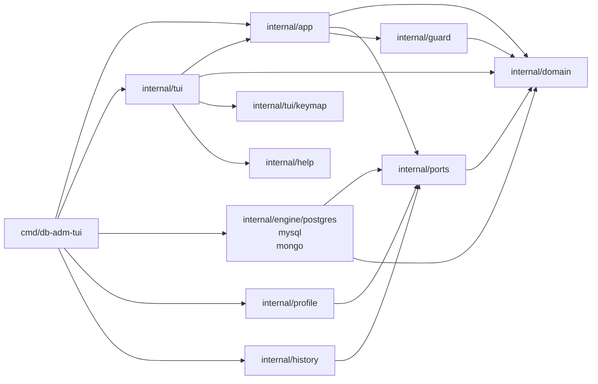
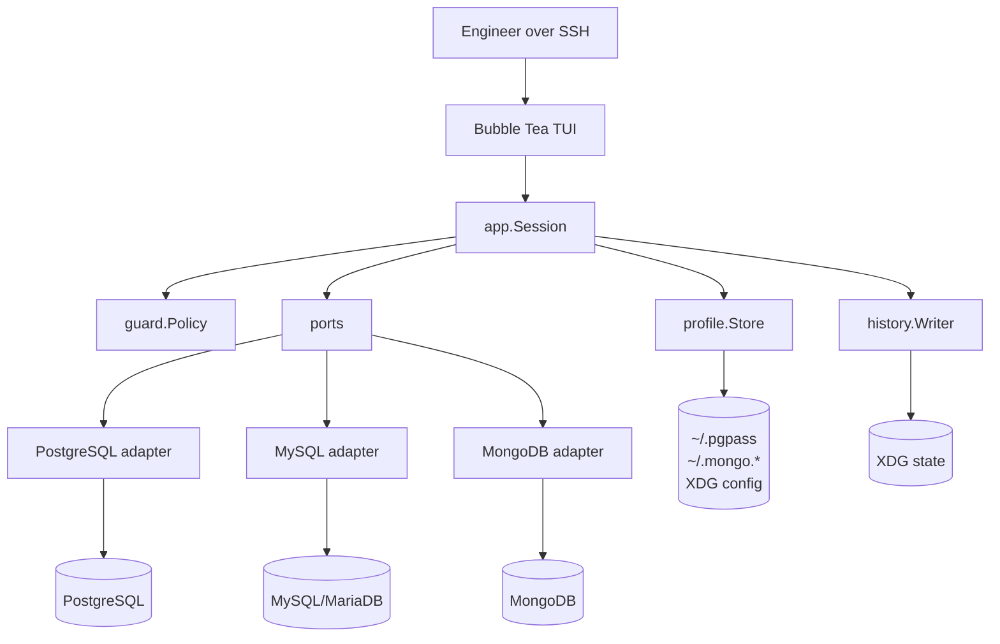

# Architecture Spine — db-adm-tui

## Design Paradigm

**Hexagonal (ports and adapters) with an MVU edge.** The domain and application are independent of terminals and database drivers. Bubble Tea's Model-Update-View pattern governs only the TUI adapter; `tea` never appears in `domain`, `app`, `ports`, or `engine`.

The dependency rule is the architecture:



- `domain` — types, errors, window, privilege terms, guard policy; no driver, TUI, or I/O imports.
- `app` — session lifecycle, mode, operation serialization, use cases.
- `ports` — small capability interfaces shared by app and adapters.
- `engine/{postgres,mysql,mongo}` — database adapters.
- `profile`, `history` — file-backed adapters.
- `tui` — Bubble Tea models, custom grid, theme, keymap, help rendering.
- `cmd/db-adm-tui` — the only composition root.

## Invariants & Rules

### AD-1 — Hexagonal core, MVU edge

- **Binds:** all packages.
- **Prevents:** TUI/engine coupling, driver-specific logic leaking into the app or UI, and untestable seams.
- **Rule:** imports point inward only: `domain ← app ← tui`, `domain ← ports ← engine/profile/history`. `tui` and `engine` never import each other. Only `cmd` wires concrete adapters. `domain` imports the standard library only.

### AD-2 — One serialized connection per session

- **Binds:** FR-10..FR-30, NFR-5, NFR-6.
- **Prevents:** concurrent use of one `*sql.Conn` or cursor, read-only session drift, and overlapping queries on a single-user tool.
- **Rule:** `app.Session` owns exactly one engine connection per session. Every engine operation acquires a capacity-1 semaphore and a `context.Context`; no pool or second connection in v1. SQL adapters use one `*sql.Conn` from a `sql.DB` configured with `MaxOpenConns=1`/`MaxIdleConns=1`; MongoDB uses one client. An open query-result cursor holds the same lease until `Esc`; other engine-backed actions queue or reject with `busy`. Disconnect closes the connection, cancels the root context, and returns to the picker.

### AD-3 — Capability ports, no god interface

- **Binds:** FR-1..FR-9, FR-37..FR-41.
- **Prevents:** a lowest-common-denominator Engine interface and `ErrNotImplemented` branching in the TUI.
- **Rule:** define small ports — `Catalog`, `DataReader`, `StatsReader`, `PrivilegeReader`, `QueryExecutor`, `ModeController`, `ProfileStore`, `HistoryStore`. An engine returns `ports.SessionBundle{Session, Catalog, DataReader, StatsReader, PrivilegeReader, QueryExecutor, ModeController}` with nil for unsupported ports; `Capabilities` is derived from the non-nil ports, never supplied independently. `ModeController` is always non-nil; MongoDB's is a no-op with `SessionReadOnly=false`. `Catalog` exposes `OrderKey(ctx, ObjectRef)` for table paging. The app checks the bundle; the TUI never sees a port or a driver.

### AD-4 — State ownership and async generations

- **Binds:** FR-4, FR-10..FR-25, NFR-6.
- **Prevents:** shared mutable UI/session state, stale async results, and duplicate operations.
- **Rule:** the TUI model owns view state (selection, tabs, filters, loaded window, render); `app.Session` owns connection, mode, queue, and request generations; the engine owns connections and cursors. No mutable globals. Every `tea.Cmd` carries a request generation; results with a stale generation are dropped. One engine operation runs at a time.

### AD-5 — Unified grid model

- **Binds:** FR-10..FR-17, FR-25.
- **Prevents:** SQL rows and MongoDB documents rendered through divergent shapes, and ad-hoc cell formatting in the TUI.
- **Rule:** both SQL and MongoDB adapters produce `domain.Grid`: ordered `Column`s and `Cell`s with `Text`, `Null`, and `Kind`. Nested objects/arrays render as compact JSON. Null and empty string are distinct. The TUI renders only `Grid`.

### AD-6 — Table windows versus query cursors

- **Binds:** FR-10..FR-17, FR-25, NFR-5.
- **Prevents:** offset re-fetch on a forward-only cursor and inconsistent eviction.
- **Rule:** table/collection browsing uses offset windows with a stable order from `Catalog.OrderKey`: SQL uses the primary key; if none exists it warns about repeat/skip; MongoDB defaults to `_id` ascending. Evicted pages are re-fetched. Query results use a forward-only cursor materialized up to the 10,000-row/64 MB cap and are never re-fetched; `m`/`Ctrl+A` drain from the open cursor; at the cap the status says `cap reached`; `Esc` closes the cursor and releases the session lease.

### AD-7 — Read-only guard is a domain service

- **Binds:** FR-27..FR-30, NFR-9.
- **Prevents:** TUI-level enforcement, driver bypass, mode-state drift, and inconsistent block reasons.
- **Rule:** every execution passes `guard.Policy.Check(ctx, statement, mode)` before a port call. SQL uses a conservative tokenizer (comments/strings stripped, top-level and CTE writes, `EXPLAIN ANALYZE` writes, `SET TRANSACTION READ WRITE`); MongoDB uses an allowlist of `find`/`aggregate`/`count`/`distinct` plus stage inspection. Unknown input blocks. On the same `*sql.Conn`, PostgreSQL runs `SET default_transaction_read_only = on` and `SET SESSION CHARACTERISTICS AS TRANSACTION READ ONLY`; MySQL/MariaDB runs `SET SESSION TRANSACTION READ ONLY`; both are cleared only in read-write mode. MongoDB has no session layer, so the guard is the only layer. The app owns the mode; blocked statements never reach the engine. The guard is a product safeguard, not a security boundary.

### AD-8 — Profiles and credential resolution

- **Binds:** FR-31..FR-36, FR-46, NFR-7.
- **Prevents:** passwords in profiles, logs, or argv; divergent pgpass/mongo parsing; profile schema drift.
- **Rule:** profiles are JSON at `$XDG_CONFIG_HOME/db-adm-tui/profiles.json`, schema v1: `version`, `label`, `engine`, `host`, `port`, `database`, `user`, optional `source`, `created_at`, `updated_at`, `last_used`; the file and directory are `0600`/`0700`. Passwords are resolved at connect from `~/.pgpass`, a selected `~/.mongo.*` file, or a one-time prompt; never persisted. `~/.pgpass` honors `0600`, `\` escaping, `*` wildcards, first match, and `PGPASSFILE`. A malformed MongoDB file errors with its name. The profile adapter owns parsing; no raw DSN or password appears in an error.

### AD-9 — History and state

- **Binds:** FR-42..FR-45, NFR-7.
- **Prevents:** unbounded history, secrets on disk, and history failures blocking queries.
- **Rule:** `commands.jsonl` and `commands.log` under the history path, created `0600`. Each JSONL record carries `ts`, `profile`, `engine`, `statement`, `mode`, `duration_ms`, `status`; the TXT line is a human-readable form of the same. Credentials and password literals are redacted to `***`. Rotate at 10 MB × 5 files per format. Writes are best-effort: a failure warns and never blocks a query. The app writes history; the TUI never does.

### AD-10 — Keymap, completion, help

- **Binds:** FR-18, FR-21, FR-22, NFR-12.
- **Prevents:** layout-dependent shortcuts, per-keystroke database calls, and help/completion drift.
- **Rule:** one central `keymap` binding table normalizes Latin and Cyrillic physical positions, including chord finals; all letter shortcuts go through it, and tests cover every binding in both layouts. `F1` is layout-independent keymap help. Completion is local from cached catalog/fields, static dialect keywords, and recent identifiers; no database round-trip per keystroke. `helpdata/<engine>/*.md` is the source; `make update-help` validates every completion term across enabled drivers, writes the generated index under `internal/help`, and fails on a missing entry. Help is offline. The TUI rejects terminals below 80×24 with the too-small state and never relies on color alone.

### AD-11 — Errors, redaction, terminal safety

- **Binds:** NFR-6, NFR-7, NFR-8.
- **Prevents:** secret leakage, ANSI injection, inconsistent error UX, and panics on engine errors.
- **Rule:** adapters return `domain.Error` with `Kind`, `Op`, and a wrapped cause. Raw driver text and DSNs are redacted before they leave the adapter. All external strings — database content, pasted query text, source-derived values, filenames — are sanitized of ANSI/control sequences before rendering. The TUI maps `Kind` to copy and never branches on error strings; no engine error panics the program.

### AD-12 — Engine adapter rules

- **Binds:** FR-1..FR-3, FR-37..FR-39.
- **Prevents:** engine-specific branching in app/TUI and divergent catalog semantics.
- **Rule:** PostgreSQL and MySQL share `database/sql` execution; dialect-specific catalogs, privileges, regex flags, and read-only session settings live in their adapters. MongoDB uses the official driver and the restricted MQL surface. Adapters expose native terms; the app and TUI never translate privileges into a cross-engine vocabulary. Unsupported capabilities are `Capabilities=false` or `ErrUnsupported`, never a silent empty result.

### AD-13 — Build, deployment, operations

- **Binds:** NFR-1..NFR-5, NFR-10..NFR-14.
- **Prevents:** runtime dependencies, cross-compile drift, hidden network/ports, and release inconsistency.
- **Rule:** `CGO_ENABLED=0` static binary; cross-compile Linux `amd64` and `arm64` with `-trimpath -ldflags="-s -w"` and embedded version/commit/date. No daemon, listening ports, telemetry, or update checks; network calls go only to the selected database endpoints. Configuration and state use XDG paths. Make targets: `build`, `test`, `lint`, `update-help`, `release`. The terminal is restored on every exit path.

## Consistency Conventions

| Concern | Convention |
|---|---|
| Naming | Go packages lowercase; ports named by capability (`Catalog`, `DataReader`); no `I` prefixes; engine dirs `internal/engine/<kind>`; AD IDs stable and never reused. |
| Data & formats | Profiles: JSON schema v1 at `$XDG_CONFIG_HOME/db-adm-tui/profiles.json`. History: `commands.jsonl` + `commands.log`. Timestamps: RFC3339. Request generations: monotonic `uint64`. Grid cells: `text`, `number`, `bool`, `null`, `json`, `binary`, `datetime`; null flag distinct from empty. Native privilege terms verbatim. |
| State & cross-cutting | No mutable globals. `app.Session` serializes engine calls. Every operation takes a context. Metadata calls time out at 30 s; connect at 10 s; user queries/counts have no default timeout and are cancellable. Mode is app-owned. |
| Errors | `domain.Error` kinds: `auth`, `permission`, `not_found`, `timeout`, `cancelled`, `guard`, `engine`, `config`. No raw driver/DSN text. |
| Redaction | Passwords, DSN userinfo, and password literals are redacted at the adapter boundary and again before history write. |
| Terminal safety | Strip ANSI/control sequences from every external string before Lip Gloss. |
| Visual tokens | `internal/tui/theme` maps DESIGN.md semantic tokens to Lip Gloss styles; no literal hex outside the theme. |
| Logging | No telemetry and no log file by default. Diagnostics are opt-in and redacted; release builds have no debug egress. |

## Stack

| Name | Version |
|---|---|
| Go | 1.26.0+ (module `go 1.26.0`; Bubble Tea v2 requires 1.26+) |
| Bubble Tea | `charm.land/bubbletea/v2` v2.1.2 |
| Lip Gloss | `charm.land/lipgloss/v2` v2.1.1 |
| Bubbles | `charm.land/bubbles/v2` v2.2.1 |
| pgx (stdlib) | `github.com/jackc/pgx/v5` v5.11.0 |
| MySQL driver | `github.com/go-sql-driver/mysql` v1.10.2 |
| MongoDB driver | `go.mongodb.org/mongo-driver/v2` v2.10.0 |
| Module | `github.com/mcgru/db-adm-tui` [ASSUMPTION: finalized at repo creation] |
| Engine matrix | PostgreSQL 14+; MySQL 8.0+; MariaDB 10.4+; MongoDB 6.0+ |
| Build | `CGO_ENABLED=0`; pure-Go drivers; Linux `amd64` / `arm64` |

## Structural Seed

```text
db-adm-tui/
  cmd/db-adm-tui/main.go
  internal/
    domain/          # types, errors, window, guard policy, grid
    app/             # session, mode, use cases, generations
    ports/           # Catalog, DataReader, StatsReader,
                     # PrivilegeReader, QueryExecutor, ModeController,
                     # ProfileStore, HistoryStore
    engine/
      postgres/      # database/sql + pgx stdlib
      mysql/         # database/sql + go-sql-driver
      mongo/         # official driver + MQL
    profile/         # pgpass/mongo parsers, JSON store
    history/         # JSONL/TXT, redaction, rotation
    guard/           # SQL tokenizer, Mongo classifier, policies
    help/            # embedded help + generated index
    tui/             # root model, screens, components, theme
      keymap/        # Latin/Cyrillic aliases
  helpdata/          # Markdown source for make update-help
  Makefile
```



## Deployment & Operations

- One static binary runs in the foreground on the database host, reached over SSH. No daemon, no listening ports, no service manager, no runtime.
- Environments are dev and closed/production hosts; the same binary and the same local source files. There is no server-side component, cloud provider, or infrastructure dependency.
- Configuration and profiles live under `$XDG_CONFIG_HOME/db-adm-tui`; history and state under `$XDG_STATE_HOME/db-adm-tui`. Nothing is written to the database host outside these paths.
- Operations: start at the picker, connect, `Ctrl+D` to disconnect, `q` to quit at the picker. A connection loss returns to the picker. A running query/count is cancellable; the terminal is restored on exit.
- Release: `make release` produces tarballs for Linux `amd64` and `arm64`; checksums and CI automation are deferred.

## Verification

- `make test` runs `go test -race ./...` with unit tests for domain, window, guard, profile parsers, history redaction/rotation, and keymap aliases.
- Golden tests call `Update`/`View` at 80×24 for the workspace, empty/error/filtered states, both modes, `terminal too small`, and `results open — Esc to release`; no terminal is required.
- Contract tests verify that every engine bundle derives capabilities from non-nil ports, `Page` returns exactly the requested limit or `HasMore=false`, `SetReadOnly` sets and clears the SQL session, and `make update-help` fails on a missing completion term.
- Performance checks: cold-start and first-data-page benchmarks on the reference host, a TUI render benchmark for a 10k window, and a memory-cap test.
- Fuzz targets cover the SQL tokenizer, Mongo command classifier, pgpass parser, and mongo-file parser.
- `make test-integration` is opt-in via environment (`DB_ADM_TEST_*`) and real databases; it is not required by `go test ./...`.
- `make lint` runs `go vet`; static analysis beyond vet is deferred.
- `make build` proves the static cross-compile path; version/commit/date are embedded via ldflags.

## Capability → Architecture Map

| Capability / Area | Lives in | Governed by |
|---|---|---|
| Profiles, import, new connection | `app` + `profile` | AD-3, AD-8 |
| Common tree and Security node | `app` + `ports.Catalog` + `tui` | AD-1, AD-3, AD-4 |
| Object details and statistics | `ports.StatsReader` + `tui` | AD-3, AD-5 |
| Data browsing, paging, search | `ports.DataReader` + `domain.Window` + `tui` | AD-5, AD-6 |
| Global search case mode | `tui` state + `app` | AD-10 |
| Query bar, completion, Results | `ports.QueryExecutor` + `guard` + `tui` | AD-6, AD-7, AD-10 |
| Read-only guard and mode switch | `guard` + `app` + engine adapters | AD-7, AD-12 |
| Privilege inspection | `ports.PrivilegeReader` + `tui` | AD-3, AD-12 |
| Command history | `app` + `history` | AD-9 |
| Keyboard and help | `tui/keymap` + `help` | AD-10 |
| Static build and deployment | `Makefile` + `cmd` | AD-13 |

## Deferred

- **Release engineering:** CI provider, signing, checksums, package managers. The Makefile contract is fixed; automation is not.
- **Public release posture and project license:** personal-first, public-ready; license choice waits for the release decision.
- **Help corpus authoring:** `make update-help` and embedding are fixed; the actual keyword/function/UI content is content work with its own review.
- **Integration test infrastructure:** Docker Compose or testcontainers is opt-in; no container runtime is a build dependency.
- **Advanced static analysis:** `staticcheck`/`golangci-lint` beyond `go vet`.
- **Logging/diagnostics policy:** no log file by default; opt-in debug diagnostics are deferred.
- **i18n and per-profile themes:** English and Nightshift only in v1.
- **Additional engines and NoSQL adapters:** the `DocumentEngine` capability leaves room, but v1 ships PostgreSQL, MySQL/MariaDB, and MongoDB only.
- **V2/v3 product scope:** privilege matrix, native command preview, audit trail, data edits, sorting, export, views/sequences data views.
- **Windows and non-Linux hosts:** best-effort only, not tested.
- **Multi-connection workspaces and shared profiles.**
